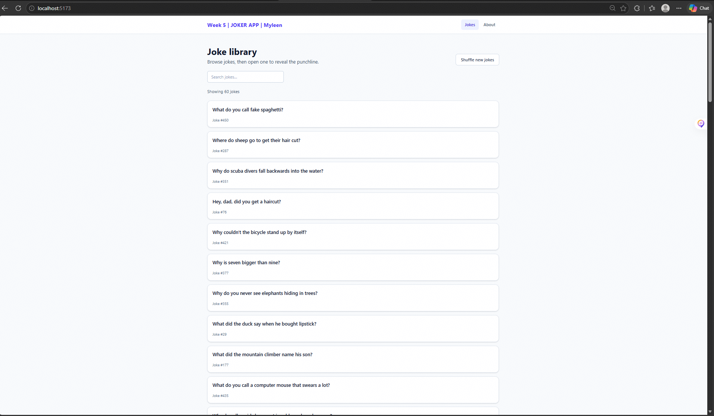
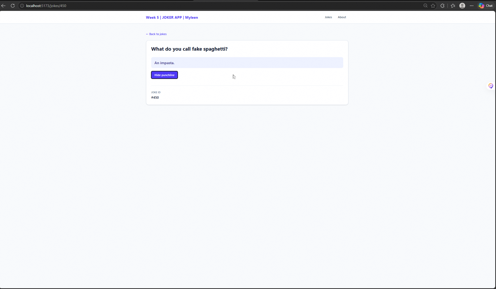
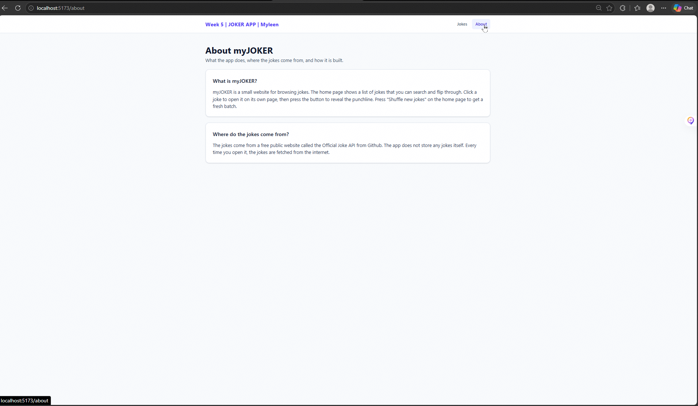

# myJOKER

A website to browse and search jokes, and reveal each punchline.

## Pages

- `/` Jokes: a list of 60 jokes with a search box and a "Shuffle new jokes" button.
- `/jokes/:id` Joke detail: one joke, picked by the number in the address (for example `/jokes/450`), with a button to reveal the punchline.
- `/about` About: a short description of what the app is and where the jokes come from.

## API

[Official Joke API](https://github.com/15Dkatz/official_joke_api) (free, no key).

## TanStack Query

It fetches the jokes and remembers them. The Jokes and Joke detail pages handle:

- **Loading:** grey placeholder boxes.
- **Error:** red message with "Try again". See it at `/jokes/999999`.
- **Empty:** "No jokes match" message. See it by searching `zzzz`.

## Screenshots





## Setup

```bash
git clone https://github.com/MYLEENDEVILLA/myleen-joker-app.git
cd myleen-joker-app
npm install
npm run dev
```

## Tech stack

React, React Router, TanStack Query, Tailwind CSS, Vite.
